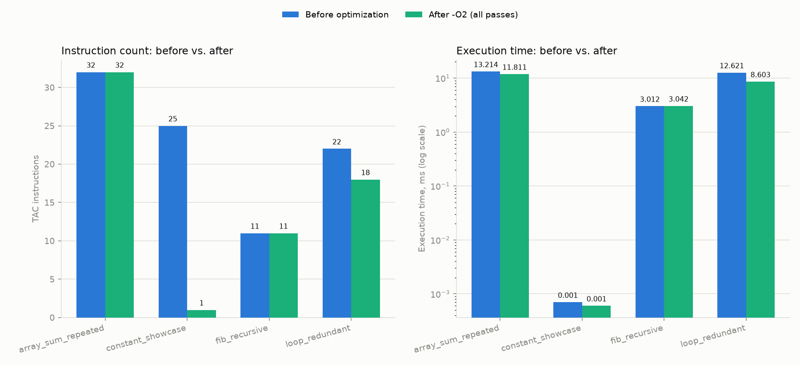

# NovaLang: A Mini-Language Compiler with an Optimizing Backend Targeting LLVM IR

Project report

## Abstract

NovaLang is a compiler for a small, statically-typed procedural language,
implemented in Python and taking source code through every classical
compiler phase — lexical analysis, syntax analysis, semantic analysis,
intermediate-code generation, optimization, and code generation — before
executing the result as genuine native machine code via LLVM. The project
deliberately keeps the language small (no OOP, generics, closures,
pointers, or a standard library) so that engineering effort goes into the
compiler's internals rather than language design: a hand-written lexer and
recursive-descent parser with GCC/Clang-style multi-error recovery, a
symbol-table-based semantic analyzer, a control-flow-graph intermediate
representation, four independently toggleable optimization passes with
measured before/after impact, and LLVM-backed code generation. 154
automated tests cover all six phases; a four-program benchmark suite
demonstrates that the optimizer's impact is real, measured, and
non-uniform — sometimes a 96% reduction in generated instructions,
sometimes a 1.47x runtime speedup, and sometimes (honestly) no
improvement at all, depending on what the source program actually gives
the optimizer to work with.

## 1. Introduction

### 1.1 Motivation

Most student compiler projects stop at "it parses and interprets the
language." This project's explicit goals were to go further in three
specific, verifiable ways:

1. **Produce real machine code, not an interpreter.** NovaLang source is
   translated all the way to LLVM IR and executed as compiled native
   instructions, not walked by an AST-interpreting loop.
2. **Make optimization measurable, not just claimed.** Every optimization
   pass can be toggled independently via the CLI, and a benchmark suite
   reports actual instruction-count and execution-time deltas — including
   the cases where optimization doesn't help, which is itself an honest
   and informative result.
3. **Recover from errors like a real compiler.** Panic-mode recovery in
   the parser means a single syntax mistake doesn't abort the whole
   compile; multiple independent errors are reported in one pass, as a
   production compiler would.

### 1.2 What NovaLang Looks Like

```
func factorial(n: int) -> int {
    if (n <= 1) {
        return 1;
    } else {
        return n * factorial(n - 1);
    }
}

func main() -> int {
    let x: int = 10;
    let arr: int[5] = [1, 2, 3, 4, 5];
    let sum: int = 0;

    for (let i: int = 0; i < 5; i = i + 1) {
        sum = sum + arr[i];
    }

    print(factorial(x));
    print(sum);
    return 0;
}
```

Supported: `int`, `float`, `bool`, `string`, fixed-size 1-D arrays;
`if`/`else`/`while`/`for`; functions with parameters, return values, and
recursion; the full set of arithmetic/relational/logical/assignment
operators; a built-in `print()`; and static, non-implicit type checking.
Deliberately excluded: classes, closures, generics, dynamic typing,
pointers, general string manipulation, and a standard library — see
§9 for the full, explicitly-recorded scope-decision log this project
kept throughout development (`docs/decisions.md`, 13 numbered decisions).

### 1.3 Architecture

```
 .nova source
      |
      v
 +-----------------+
 |  1. Lexer        |  ->  token stream
 +-----------------+
      |
      v
 +-----------------+
 |  2. Parser       |  ->  Abstract Syntax Tree
 +-----------------+
      |
      v
 +-----------------------+
 |  3. Semantic Analyzer  |  ->  type-annotated AST + symbol table
 +-----------------------+
      |
      v
 +-----------------+
 |  4. IR Generator |  ->  Three-Address Code (basic blocks + CFG)
 +-----------------+
      |
      v
 +------------------------+
 |  5. Optimizer (4 passes)|  ->  optimized TAC
 +------------------------+
      |
      v
 +-----------------+
 |  6. Code Gen      |  ->  LLVM IR
 +-----------------+
      |
      v
   llvmlite MCJIT  ->  in-process native execution
```

Every phase is a separate, independently testable Python module under
`novac/`: `lexer.py`, `parser.py` (+ `ast_nodes.py`), `semantic.py`,
`ir.py` + `ir_gen.py`, `optimizer/` (four pass modules + a pass manager),
and `codegen.py`. `cli.py` wires them together into the `novac` command
(`python -m novac`), including a `--dump-stage` flag that prints the
output of any stage — tokens, AST, TAC, optimized TAC, or LLVM IR — for
exactly the kind of "show the transformation at every step" demo a
compiler course rewards.

## 2. Phase 1: Lexical Analysis

`novac/lexer.py` is a hand-written, character-by-character scanner (no
regex-based tokenizer, no Flex) producing a flat token stream: keywords,
identifiers, `int`/`float`/`bool`/`string` literals, every operator and
punctuation mark in the grammar, and `//` line comments (a lexical detail
the original language sketch didn't specify, so it was decided and
recorded rather than left implicit).

**Error handling.** Invalid input never crashes the scanner. An
unterminated string, a malformed numeric literal (e.g. `12x`), or an
unrecognized character each produce an `ERROR` token carrying a message
and a `line:col` position; scanning simply continues from there. A
`MAX_ERRORS = 20` cap (shared with the parser and semantic analyzer,
§9 #6) stops a pathologically broken input file from producing unbounded
error output. 16 tests cover the full token set, line/column tracking
across newlines, comment stripping, and every recovery path.

## 3. Phase 2: Syntax Analysis

`novac/parser.py` is a hand-written recursive-descent parser built
directly against the grammar in `docs/grammar.ebnf`, with one function
per grammar production and a standard precedence-climbing expression
parser (`logicOr -> logicAnd -> equality -> relational -> additive ->
multiplicative -> unary -> postfix -> primary`). `novac/ast_nodes.py`
defines the resulting AST as plain dataclasses.

**Panic-mode error recovery** is the parser's headline feature: on a
syntax error, it records the error and skips tokens until a
synchronization point (`;`, `}`, or a token that plausibly starts a new
statement/declaration), then keeps parsing — so a typo in one function
doesn't prevent the compiler from also reporting the two unrelated
mistakes in the next one. `examples/errors/multiple_errors.nova`
demonstrates this concretely: three independent syntax errors across
three functions are all reported from a single `python -m novac`
invocation.

While building this, a bug surfaced that most test suites wouldn't have
caught: when the lexer's own `MAX_ERRORS` cap triggers, its token stream
could end without an `EOF` token, which sent the parser's position
counter past the end of the list (`IndexError`). The fix — always
terminate the token stream with `EOF`, even on an early exit — was found
by a test that deliberately fed 30 invalid characters to the pipeline; it
is now a permanent regression test.

29 parser tests cover the full grammar, operator precedence, `if`/`else
if`/`else` chains, `for`-loop desugaring, array literals and indexing,
and panic-mode recovery (including the `MAX_ERRORS` cap itself).

## 4. Phase 3: Semantic Analysis

`novac/semantic.py` implements a two-pass analyzer. **Pass 1** collects
every function's signature (name, parameter types, return type) before
checking any body, so recursion, forward references, and mutual
recursion (`isEven`/`isOdd` calling each other regardless of definition
order) all resolve correctly. **Pass 2** walks each function body against
a chained `Scope` (a linked list of name→type dictionaries, one per
lexical block), enforcing:

- **No implicit type conversion**, anywhere — `int op float` is a
  compile-time error in binary operations, variable initializers,
  assignments, return statements, and call arguments alike. This single,
  uniformly-applied rule (§9 #4) removes an entire category of "which
  direction does this promote, and what does codegen do about it"
  decisions.
- **Strings are `print()`-literal-only** (§9 #2) — no string variables,
  concatenation, comparison, or indexing. Enforced by rejecting any
  `string`-typed variable/parameter/return declaration, and by only
  permitting a `StringLiteral` node to type-check when it is the direct
  argument of a `print()` call.
- **Array bounds checking, exactly one case** (§9 #3): a compile-time
  error is raised if and only if both the array's size and the index are
  integer literals known at compile time, and the index falls outside
  `[0, size)`. Anything involving a variable index is an explicitly
  unchecked runtime concern.
- **Arrays are local-variable-only** (§9 #11) — never a function
  parameter or return type. This was added mid-project while designing
  the optimizer's common-subexpression elimination pass, which needs to
  reason about whether a function call could mutate an array through an
  aliased reference; disallowing arrays from crossing function
  boundaries makes the answer "never," rather than requiring a real
  pass-by-value/pass-by-reference design decision nobody had actually
  asked for.
- **Undeclared variable/function detection**, duplicate-declaration and
  duplicate-parameter detection, and unreachable-code-after-return
  detection (checking not just a literal `return` statement but also an
  `if`/`else` where *both* branches unconditionally return — a case the
  first version of this check missed, caught by a dedicated test before
  it could bite Phase 4, which relies on the guarantee that nothing
  follows a fully-terminating statement).
- **All-paths-return checking** — not requested by the original language
  spec, but added because every NovaLang function has a concrete
  (non-`void`) return type, and the IR's basic-block model (§5) requires
  every block to end in exactly one terminator. A function that could
  fall off its end without returning would produce an LLVM block with no
  terminator and fail LLVM's verifier outright; this check turns that
  into a clear, early, source-level error instead of an opaque Phase 6
  failure.

The analyzer annotates every expression node's AST with its resolved
`Type`, which Phase 4 consumes directly rather than re-deriving type
information from scratch. 30 tests cover the full rule set, including
the forward-reference/mutual-recursion case and the `MAX_ERRORS` cap.

## 5. Phase 4: Intermediate Code Generation

### 5.1 Representation

`novac/ir.py` implements three-address code as real Python dataclasses —
`BinOp`, `UnaryOp`, `Copy`, `ArrayLoad`, `ArrayStore`, `Call`, `Print` as
value-producing instructions; `Branch`, `CondBranch`, `Return` as the
only terminators — grouped into `BasicBlock`s with an explicit CFG
(`preds`/`succs` derived from each block's terminator). This was a
deliberate up-front choice (§9 #9, #1): building basic blocks from day
one, rather than a flat instruction list, means Phase 5's dead-code
elimination and Phase 6's LLVM codegen both map naturally onto the same
block structure LLVM itself uses, instead of requiring a CFG to be
reconstructed later. The IR is **not SSA** — named variables and
temporaries are plain, reassignable operands — trading some optimizer
sophistication (no cross-block value propagation without real dataflow
analysis) for a much simpler, more debuggable code generator.

### 5.2 Generation

`novac/ir_gen.py` walks the type-annotated AST into this IR. `if`,
`while`, and `for` each produce the block shapes described in
`docs/tac_spec.md` (then/else/merge; cond/body/after); critically, an
`if`/`else` where **both** branches always return never gets a merge
block created at all — Phase 3's strengthened unreachable-code check
guarantees no live code could ever reach it, so it is never generated
rather than generated-and-orphaned.

`&&` and `||` are lowered as real conditional branches with a shared
temp reassigned along each incoming edge — not as a plain `BinOp` — which
matters for correctness, not just style: a flat `BinOp` would evaluate
both operands unconditionally, breaking short-circuit semantics. This is
directly testable and tested: `false && (1 / 0 > 0)` must not crash,
because the division is never reached.

**Shadowing safety.** Because the IR is not SSA, a naive design would let
two source-level variables named `x` in different (legally shadowing)
scopes collide under the same flat name. `ir_gen.py` keeps its own `Env`
chain — separate from `semantic.py`'s `Scope` — that mints a unique
suffixed name per declaration (`x.0`, `x.1`, ...) so shadowing is safe by
construction rather than by convention.

15 tests cover block structure for every control-flow construct, the CFG
edges, array load/store, short-circuit branching, shadowed-variable
uniqueness, and a whole-program check that every generated block
(including a nested `if` inside a `for` inside a recursive function) has
exactly one terminator.

## 6. Phase 5: Optimization

Four independently toggleable passes, selectable via
`--passes=const-fold,const-prop,dce,cse` or the `-O0`/`-O1`/`-O2`
aliases, run by a pass manager (`novac/optimizer/__init__.py`) that
repeats the selected subset until a full round changes nothing.

- **Constant folding** evaluates `BinOp`/`UnaryOp` instructions whose
  operands are both compile-time constants, and simplifies a
  constant-condition `CondBranch` into a plain `Branch` (which typically
  hands DCE a whole dead branch to remove next round). Integer `/` and
  `%` use **C-truncating semantics** (`-7 / 2 == -3`, not Python's
  floor-based `-7 // 2 == -4`) specifically because Phase 6 emits LLVM's
  `sdiv`/`srem`, which truncate the same way — if compile-time folding
  and runtime execution disagreed on negative operands, `-O2` could
  silently compute a different answer than `-O0`, which would be a
  correctness bug hiding inside the project's own headline claim.
- **Constant propagation** forwards a known-constant value to later uses
  within the same basic block, deliberately scoped local-to-block to
  match CSE's scope rather than building real reaching-definitions
  dataflow analysis.
- **Common subexpression elimination** recognizes a repeated
  `BinOp`/`UnaryOp`/`ArrayLoad` within one block and replaces the second
  computation with a copy of the first. An `ArrayStore` invalidates any
  cached load of that same array (aliasing safety); no such handling is
  needed for `Call`, since arrays can never cross a function boundary
  (§4, §9 #11).
- **Dead code elimination** combines unreachable-block elimination
  (BFS reachability from the entry block) with dead-instruction removal.
  This pass's dead-instruction check deliberately looks at **whole-
  function** operand usage, not just same-block usage as originally
  sketched in `docs/tac_spec.md` — a same-block-only check would be
  *unsound*: short-circuit codegen (§5.2) defines a temp in one block and
  reassigns it in another before its only use in a third, so a
  same-block liveness check would have wrongly deleted it. `dce.run()`
  also iterates to its own fixed point internally (removing one dead
  instruction can reveal another was only used by it), found by a test
  that called it once and observed a real one-layer-short bug.

Each pass is unit-tested against hand-shaped programs (20 tests total),
and a dedicated end-to-end test compiles the same non-trivial program
through `-O0` and through every pass, asserting **byte-identical return
value and printed output** — the project's core "measurable,
behavior-preserving optimization" claim, verified rather than merely
argued.

## 7. Phase 6: Code Generation

`novac/codegen.py` translates the (optionally optimized) TAC into LLVM
IR via `llvmlite`, and executes it via `llvmlite`'s bundled MCJIT engine.

**No external toolchain.** The original plan assumed `llc`/`clang` would
turn generated `.ll` into a native binary. In practice, the primary
development machine has no administrator rights (`winget install
LLVM.LLVM` requires elevation the NSIS installer's manifest hard-requires
regardless of install directory) and a network that blocks the portable
alternative (a Zig download, which bundles `clang`+`lld` with no
installer, stalled and reset). Rather than block on infrastructure,
`llvmlite`'s own `MCJIT` execution engine became the primary path: it
JIT-compiles generated LLVM IR to real native machine code and executes
it in-process, which still satisfies "produces actual running machine
code, not an interpreter" — it just doesn't write a standalone `.exe` to
disk. A full checklist for unlocking standalone-executable output once
development moves to a machine with normal install access lives in
`docs/mac_migration.md`.

**Representation choices.** `int` → `i32`, `float` → `double` (64-bit,
for precision headroom), `bool` → `i1`. Every named variable *and* every
compiler-generated temp gets an `alloca`'d stack slot in the function's
entry block, rather than being treated as an SSA register — because
short-circuit codegen (§5.2) reassigns a shared temp across two different
blocks, which is only valid with real `phi` nodes (deliberately not
built, §9 #9) or with a stack slot. This means the generated LLVM IR is
less optimal than hand-tuned code would be, which is irrelevant here:
this project's own optimizations already ran at the TAC level in Phase
5, and re-optimizing the emitted LLVM IR itself was never in scope.

**Two-pass generation** (§9 #5) mirrors Phase 3: every function's LLVM
signature is declared before any body is emitted, so a `call` instruction
resolves regardless of source order — required for both self-recursion
(`factorial`) and mutual recursion.

**`print()` via host callbacks, not `printf`.** This is the project's
most concrete "real engineering, not textbook" story. The natural design
— declare `printf` as an external function and call it — hit a genuine
Windows-specific wall: modern Python links the Universal CRT, and
`ctypes` cannot resolve `printf` by name from the `api-ms-win-crt-*.dll`
forwarder (a virtual API-set DLL, not a normal exports table). The
legacy `msvcrt.dll` *does* resolve `printf`, and manual testing showed it
even executing correctly — but it turned out to be a second, independent
CRT instance with its own disconnected stdio buffer, so `pytest`'s
file-descriptor-level output capture never observed anything printed
through it; the output only appeared at process exit, after the test
harness had already moved on. The fix was a redesign, not a workaround:
`print()` compiles to calls against four declared external functions
(`novac_print_int`/`_float`/`_bool`/`_string`), each backed by an actual
Python function registered into the JIT via `llvm.add_symbol()`. This
sidesteps CRT-linking issues entirely, behaves identically cross-
platform, and is directly and reliably testable with `pytest`'s `capsys`.

16 codegen tests cover arithmetic, recursion, mutual recursion, loops,
arrays, negative-operand division/modulo (checked against the exact
value C semantics predicts), short-circuit safety, all four `print()`
value types, the language spec's own factorial/array-sum example matched
against its exact expected output, and the `-O0`-vs-all-passes identical-
output check described in §6.

## 8. The CLI

`python -m novac <file.nova>` ties the whole pipeline together:

```
python -m novac examples/factorial.nova --run
python -m novac examples/factorial.nova --dump-stage=tac
python -m novac examples/factorial.nova -O2 --dump-stage=optimized-tac
python -m novac examples/factorial.nova --passes=const-fold,dce --run
```

`--dump-stage` accepts `tokens`, `ast`, `tac`, `optimized-tac`, or
`llvm-ir`, printing that stage instead of compiling further — directly
supporting the "show tokens → AST → TAC → optimized TAC → LLVM IR for any
input" demo goal from the original project plan. Optimization defaults
to `-O0` (no passes, matching standard compiler convention), except
`--dump-stage=optimized-tac` alone defaults to `-O2` so a before/after
comparison against plain `--dump-stage=tac` doesn't require remembering a
second flag. `--run` JIT-compiles and executes, returning the program's
own value as the process exit code, exactly as a real compiled
executable would. Lexer, parser, and semantic errors are all reported
with `line:col` — every error found in one pass, not just the first —
and a non-zero exit code.

## 9. Design Decisions

Every deliberate scope boundary in this project was decided and written
down *before* — or, in a few cases, immediately upon discovery during —
the implementation it affects, rather than emerging ad hoc mid-coding.
The full log (`docs/decisions.md`) currently holds 13 numbered decisions;
the ones with the widest-reaching consequences are woven into the
relevant phase sections above (§3-§7). Two worth calling out specifically
for how they were *found*, not just decided:

- The **unreachable-code-after-fully-returning-if/else** gap (§3) was
  found by reasoning forward from Phase 4's needs, not by a failing test
  — a rare case of a design review catching a bug before it had a chance
  to exist.
- The **arrays-are-local-only** restriction (§3, §9 #11) was found while
  designing CSE's aliasing story in Phase 5, and fixed retroactively in
  Phase 3 — a good example of a later phase's requirements legitimately
  tightening an earlier phase's scope.

## 10. Testing Strategy

154 automated tests (`pytest`), organized one file per phase plus two
integration suites:

| File | Tests | Covers |
|---|---|---|
| `test_lexer.py` | 16 | token set, line/col tracking, comment stripping, error recovery |
| `test_parser.py` | 16 | grammar, precedence, control-flow parsing, panic-mode recovery |
| `test_semantic.py` | 30 | full type-checking rule set, scoping, all-paths-return |
| `test_ir_gen.py` | 15 | CFG shape per construct, shadowing safety, terminator invariant |
| `test_optimizer.py` | 20 | all four passes, C-truncating div/mod, cross-block-temp safety |
| `test_codegen.py` | 16 | execution correctness, all print types, optimize-preserves-behavior |
| `test_cli.py` | 16 | every `--dump-stage`, `--passes`/`-O` handling, error reporting |
| `test_examples.py` | 21 | every `examples/*.nova` program compiles and runs; every `examples/errors/*.nova` fails cleanly |
| `test_benchmarks.py` | 3 | benchmark-runner logic against a synthetic program |
| `test_toolchain_smoke.py` | 1 | the MCJIT execution path itself, independent of the rest of the pipeline |

Notably, several of the project's real bugs were caught by tests
*deliberately probing an edge the implementer had reasoned should be
safe* rather than by incidental coverage: the lexer's missing-`EOF`-on-
`MAX_ERRORS` bug, the semantic analyzer's if/else-both-return gap, and
DCE's single-round convergence gap were all found this way, before they
could reach a later phase as a harder-to-diagnose failure.

## 11. Benchmark Results

Four programs (`benchmarks/programs/`), each compiled and JIT-executed
twice — once with no optimization passes, once with all four — measuring
TAC instruction count and JIT execution time (the minimum of 5 timed
calls against an already-compiled function, so JIT setup overhead is
excluded from the measurement — see the commit that split `jit_compile()`
from `compile_and_run()` for why that separation matters). Every run
asserts the optimized and unoptimized versions return the identical
value before recording anything.

| Benchmark | Instr. before | Instr. after | Reduction | Time before (ms) | Time after (ms) | Speedup |
|---|---|---|---|---|---|---|
| `array_sum_repeated` | 32 | 32 | 0.0% | 13.214 | 11.811 | 1.12x |
| `constant_showcase` | 25 | 1 | 96.0% | 0.0007 | 0.0006 | 1.17x |
| `fib_recursive` | 11 | 11 | 0.0% | 3.012 | 3.042 | 0.99x |
| `loop_redundant` | 22 | 18 | 18.2% | 12.621 | 8.603 | 1.47x |



**Reading these results honestly** is the point, not a footnote:

- **`loop_redundant`** is the headline result: a loop body containing one
  CSE-eliminable redundant computation and one dead computation, run 2
  million times. Because the loop body is a single basic block analyzed
  *once* at compile time, the ~18% instruction-count reduction inside
  that block is paid for once and collected on every one of 2 million
  dynamic iterations — a real, measured **1.47x** wall-clock speedup.
- **`constant_showcase`** is the opposite story: a straight-line program
  full of foldable arithmetic and dead variables, with no loop to
  amplify anything. Instruction count drops **96%** (25 → 1), but at
  sub-microsecond absolute runtimes either way, "speedup" is dominated by
  measurement noise, not a meaningful effect. This is the honest
  counterpart to `loop_redundant`: optimization's *code-size* impact and
  its *runtime* impact are different claims, and this project's own data
  shows they don't always move together.
- **`fib_recursive`** and **`array_sum_repeated`** are deliberate control
  cases: recursive Fibonacci has no foldable constants or redundant
  computation for these particular four passes to find (every operand is
  a runtime value), and the array-sum benchmark's work is already
  minimal and non-redundant. Both show ~0% instruction reduction and no
  meaningful speedup — an honest report of a case where these
  optimizations, correctly, do nothing.

## 12. Conclusion and Future Work

The full pipeline — lexer through JIT execution — works end-to-end on
every feature the language spec describes, is covered by 154 tests, and
its optimizer's impact is backed by measured, non-cherry-picked
benchmark data rather than an assumed "optimizations always help" claim.

Stretch goals, in order of what would add the most value next:

1. **Standalone native executable output** (not just JIT execution) —
   blocked on this development machine specifically by no admin rights
   and a network that blocks the portable toolchain alternative, not by
   anything in the compiler's design; `docs/mac_migration.md` is a
   ready-to-follow checklist for unlocking this once real clang/lld
   access is available (`emit_object()` sidesteps the LLVM-version-
   matching concern that would otherwise arise from mixing our embedded
   LLVM with a system one).
2. **Cross-block CSE / constant propagation**, requiring real dominance
   information rather than the current local-to-block scope.
3. **Loop-invariant code motion**, requiring natural-loop detection over
   the CFG (back-edge identification) — the CFG-first design decision
   from Phase 4 makes this a bounded, well-scoped addition rather than a
   rearchitecture.
4. **Explicit cast syntax** (e.g. `(float)x`), reopening controlled
   int/float conversion without reintroducing the implicit-promotion
   ambiguity the current design deliberately avoids.
